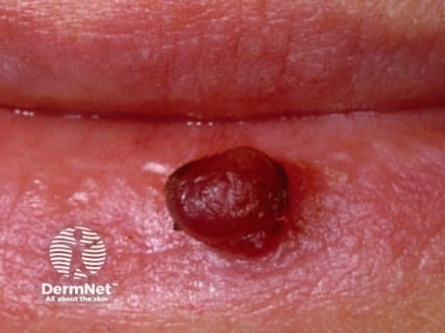
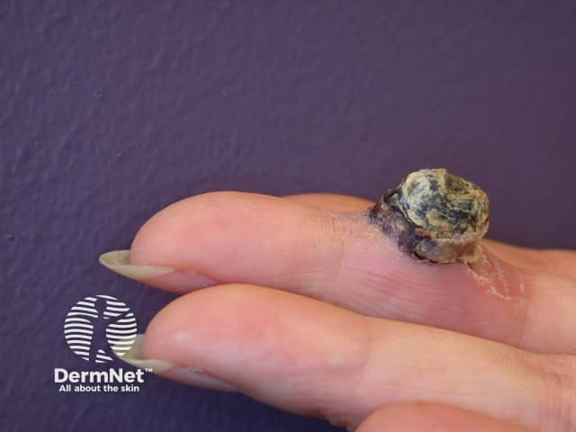

## 化膿性肉芽腫（小葉狀微血管瘤） {#atlas-d40}

**幾週內長出的紅色肉芽球，一碰就流血：典型 PG 線索。** [@A:d40]

### 辨認特徵

- 鮮紅至暗紅、濕潤而脆弱的肉芽樣丘疹／結節，可帶蒂。 [@A:d40]
- 短時間內長大，輕微摩擦便易出血；表面常糜爛、血痂或黃白纖維素覆蓋。 [@A:d40]
- 周邊可有白色領圈狀邊緣；常見於手指、顏面，也可在牙齦等黏膜。 [@A:d40]

### 最容易混淆

- 與無色素性黑色素瘤：後者同樣可為紅色、增長、易出血腫瘤，外形不能保證良性。 [@A:d40]
- 與嬰兒血管瘤：IH 有嬰兒期出現、增生再消退的時序；PG 多為後天局限性、脆弱易出血病灶。 [@A:d40]

### 驗證方法

典型者可臨床懷疑；診斷不確定或切除時送病理，確認小葉狀微血管增生。 [@A:d40]

### 判讀限制

**名稱雖有『化膿』，並非膿瘍或感染性肉芽腫；黃色表面不等於膿。** [@A:d40]

### 圖像對照

<figure class="clinical-image" data-asset-id="asset-dermatology-440e7d918367d60f"><figcaption>臨床照片 口唇下方可見深紅色、圓頂狀外生性結節，表面濕亮。Image sourced from DermNet · © DermNet · 原圖／出處 · <a href="https://dermnetnz.org/imagedetail/19588-pyogenic-granuloma" target="_blank" rel="noopener">原圖來源</a> · <a href="https://creativecommons.org/licenses/by-nc-nd/4.0/" target="_blank" rel="noopener">CC BY-NC-ND 4.0</a> · 原圖未修改</figcaption></figure>
<figure class="clinical-image" data-asset-id="asset-dermatology-9e8946de2bea2618"><figcaption>臨床照片 手指側方的外生性結節覆蓋厚黃黑色痂，周邊可見脫屑。Image sourced from DermNet · © DermNet · 原圖／出處 · <a href="https://dermnetnz.org/imagedetail/9657-pyogenic-granuloma" target="_blank" rel="noopener">原圖來源</a> · <a href="https://creativecommons.org/licenses/by-nc-nd/4.0/" target="_blank" rel="noopener">CC BY-NC-ND 4.0</a> · 原圖未修改</figcaption></figure>

[@A:d40]

### 講義所列參考頁

查看外部參考連結

以下連結由講義提供，未將這些原文視為本次已完整閱讀的獨立來源。
<ul><li><a href="https://dermnetnz.org/topics/pyogenic-granuloma" target="_blank" rel="noopener">DermNet: Pyogenic granuloma</a></li><li><a href="https://dermnetnz.org/topics/amelanotic-melanoma" target="_blank" rel="noopener">DermNet: Amelanotic melanoma</a></li></ul>

## 延伸閱讀

- [黑色素瘤](melanoma.md#atlas-d39)
- [嬰兒血管瘤](infantile-haemangioma.md#atlas-d48)
