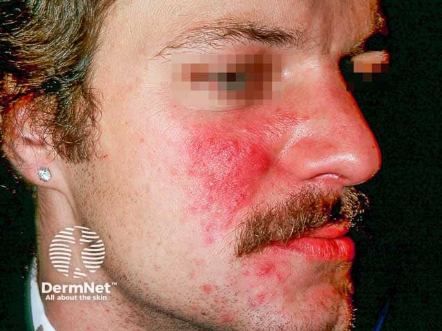
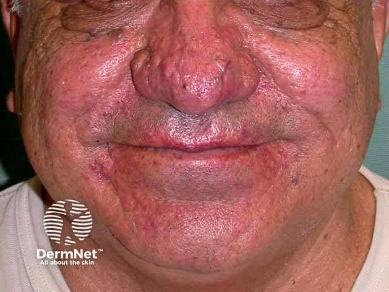

## 酒糟／玫瑰斑 {#atlas-d19}

**中央臉部反覆潮紅＋微血管擴張＋丘膿疱，缺乏典型粉刺 → 酒糟。** [@A:d19]

### 辨認特徵

- 中央臉部（雙頰、鼻、額與下巴）持續性紅斑；可見表淺擴張微血管。 [@A:d19]
- 紅底上散布丘疹、膿疱；判讀時主動找有無粉刺。 [@A:d19]
- 部分病例有鼻部皮膚增厚、毛孔粗大與結節狀鼻贅；眼瞼邊緣亦可泛紅。 [@A:d19]

### 最容易混淆

- 痤瘡：開放性／閉鎖性粉刺是重要區分點，兩病也可能並存。 [@A:d19]
- 脂漏性皮膚炎：眉間、眉毛、鼻唇溝較明顯，伴油膩細屑。 [@A:d19]

### 驗證方法

結合反覆 flushing、灼熱、誘發因素與眼部症狀作臨床診斷；紅斑與血管在深膚色可能不明顯。 [@A:d19]

### 判讀限制

**不是每位患者都有膿疱或鼻贅；「紅鼻子」本身不足以判定酒糟，更不能推定飲酒習慣。** [@A:d19]

### 圖像對照

<figure class="clinical-image" data-asset-id="asset-dermatology-ec100c15f55c8fe2"><figcaption>臨床照片 雙頰與鼻部的紅斑、細血管及散在丘疹，呈中央臉部分布。Image sourced from DermNet · © DermNet · 原圖／出處 · <a href="https://dermnetnz.org/imagedetail/3077-rosacea" target="_blank" rel="noopener">原圖來源</a> · <a href="https://creativecommons.org/licenses/by-nc-nd/4.0/" target="_blank" rel="noopener">CC BY-NC-ND 4.0</a> · 原圖未修改</figcaption></figure>
<figure class="clinical-image" data-asset-id="asset-dermatology-6e1b75b6b16c45c8"><figcaption>臨床照片 鼻部明顯增厚、分葉與毛孔擴大，呈鼻贅；合併中央臉部紅斑。Image sourced from DermNet · © DermNet · 原圖／出處 · <a href="https://dermnetnz.org/imagedetail/3058-rosacea" target="_blank" rel="noopener">原圖來源</a> · <a href="https://creativecommons.org/licenses/by-nc-nd/4.0/" target="_blank" rel="noopener">CC BY-NC-ND 4.0</a> · 原圖未修改</figcaption></figure>

[@A:d19]

### 講義所列參考頁

查看外部參考連結

以下連結由講義提供，未將這些原文視為本次已完整閱讀的獨立來源。
<ul><li><a href="https://dermnetnz.org/topics/rosacea" target="_blank" rel="noopener">DermNet - Rosacea</a></li><li><a href="https://www.aad.org/public/diseases/rosacea/what-is/symptoms" target="_blank" rel="noopener">American Academy of Dermatology - Rosacea: signs and symptoms</a></li><li><a href="https://dermnetnz.org/topics/seborrhoeic-dermatitis" target="_blank" rel="noopener">DermNet - Seborrhoeic dermatitis</a></li></ul>

## 延伸閱讀

- [脂漏性皮膚炎](seborrhoeic-dermatitis.md#atlas-d21)
