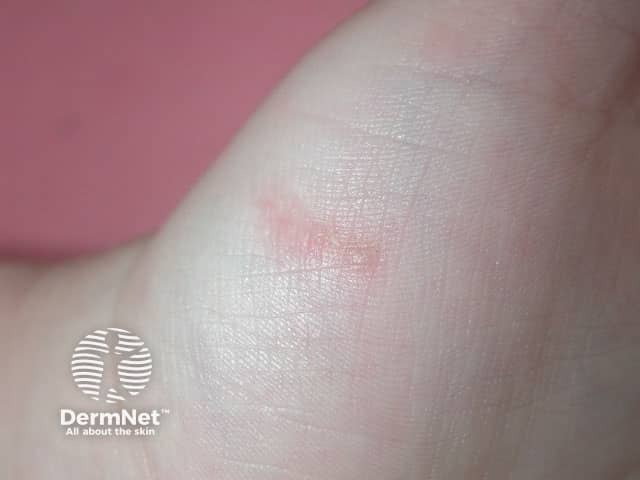
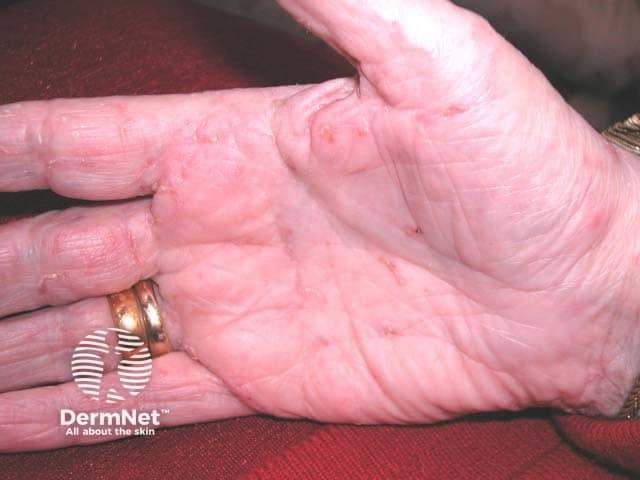

## 疥瘡 {#atlas-d28}

**指縫／手腕隧道＋夜間劇癢＋同住者也癢 → 疥瘡。** [@A:d28]

### 辨認特徵

- 指縫、手指側面、腕屈側可見小丘疹、水泡與抓痕。 [@A:d28]
- 最有辨識價值的是細短、彎曲或蛇行的灰白色隧道（burrow）。 [@A:d28]
- 可延伸到腰帶線、腋下、乳暈、臀與生殖器；嬰幼兒可累及掌蹠及頭頸。 [@A:d28]

### 最容易混淆

- 汗皰疹：指側深在透明小泡常對稱，缺少疥蟲隧道與接觸者群聚病史。 [@A:d28]
- 濕疹：可廣泛脫屑抓破；須仔細尋找疥瘡隧道，因其可被繼發濕疹掩蓋。 [@A:d28]

### 驗證方法

皮膚鏡尋找疥蟲前端的三角形影與隧道；刮片看到蟲、卵或糞便可確診，陰性不能完全排除。 [@A:d28]

### 判讀限制

**手掌紅疹本身不夠。結痂型疥瘡可有大片角化厚痂、蟲量很高，搔癢未必強烈。** [@A:d28]

### 圖像對照

<figure class="clinical-image" data-asset-id="asset-dermatology-11685752930acc23"><figcaption>臨床照片 掌心局部小水疱與相鄰細短隧道；須放大仔細看表皮線條。Image sourced from DermNet · © DermNet · 原圖／出處 · <a href="https://dermnetnz.org/imagedetail/1433-scabies" target="_blank" rel="noopener">原圖來源</a> · <a href="https://creativecommons.org/licenses/by-nc-nd/4.0/" target="_blank" rel="noopener">CC BY-NC-ND 4.0</a> · 原圖未修改</figcaption></figure>
<figure class="clinical-image" data-asset-id="asset-dermatology-289603bcb9d6f31b"><figcaption>臨床照片 手掌多處細短線狀隧道與小丘疹；與指縫、腕部的分布一起判讀。Image sourced from DermNet · © DermNet · 原圖／出處 · <a href="https://dermnetnz.org/imagedetail/1462-scabies" target="_blank" rel="noopener">原圖來源</a> · <a href="https://creativecommons.org/licenses/by-nc-nd/4.0/" target="_blank" rel="noopener">CC BY-NC-ND 4.0</a> · 原圖未修改</figcaption></figure>

[@A:d28]

### 講義所列參考頁

查看外部參考連結

以下連結由講義提供，未將這些原文視為本次已完整閱讀的獨立來源。
<ul><li><a href="https://dermnetnz.org/topics/scabies" target="_blank" rel="noopener">DermNet - Scabies</a></li><li><a href="https://www.cdc.gov/scabies/signs-symptoms/index.html" target="_blank" rel="noopener">CDC - Symptoms of scabies</a></li></ul>

## 延伸閱讀

- [汗皰疹](pompholyx.md#atlas-d50)
