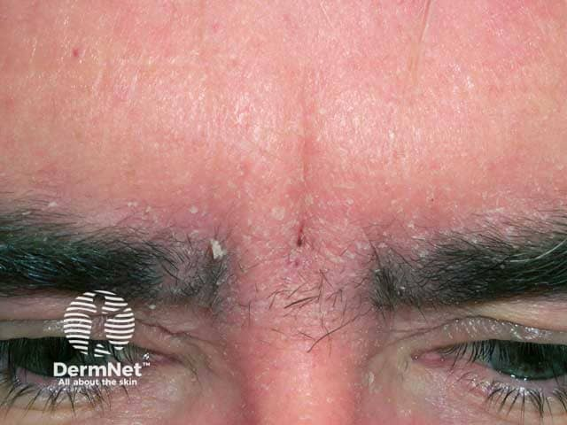
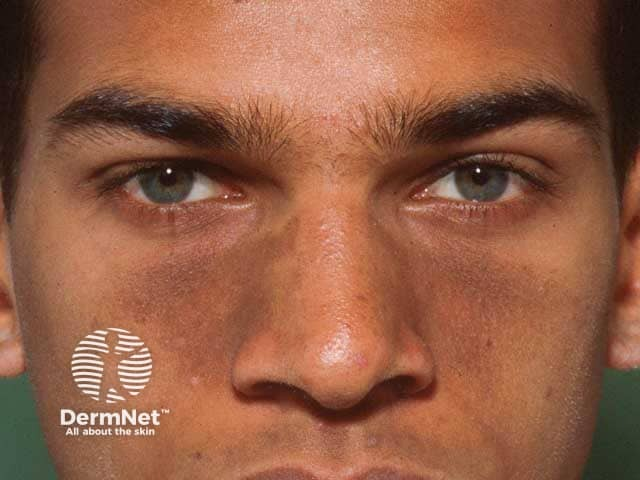

## 脂漏性皮膚炎 {#atlas-d21}

**眉間／鼻唇溝紅斑＋油膩細屑＋頭皮屑 → 脂漏性皮膚炎。** [@A:d21]

### 辨認特徵

- 邊界較不清楚的淡紅色薄斑，表面覆細薄白屑或偏黃、油膩性鱗屑。 [@A:d21]
- 典型位置為眉毛、眉間、鼻唇溝、頭皮與耳後；分布比單看油光更有價值。 [@A:d21]
- 頭皮可只有瀰漫頭皮屑；嬰兒可見黃色厚屑的 cradle cap。 [@A:d21]

### 最容易混淆

- 乾癬：常較厚、界線清楚，銀白屑較顯著；可有兩者重疊的 sebopsoriasis。 [@A:d21]
- 酒糟：中央臉部潮紅、血管擴張與丘膿疱突出，鱗屑與鼻唇溝分布較非主軸。 [@A:d21]

### 驗證方法

通常依形態和分布臨床診斷；與 Malassezia 相關，不以看到酵母菌就單獨確診。 [@A:d21]

### 判讀限制

**「臉很油」不是診斷標準；也可呈乾燥脫屑，深膚色可見色素減退。** [@A:d21]

### 圖像對照

<figure class="clinical-image" data-asset-id="asset-dermatology-9dac86aebd5d4f83"><figcaption>臨床照片 眉間、眉毛與前額交界處紅斑及細屑；注意皮脂旺盛部位的分布。Image sourced from DermNet · © DermNet · 原圖／出處 · <a href="https://dermnetnz.org/imagedetail/2055-seborrhoeic-dermatitis" target="_blank" rel="noopener">原圖來源</a> · <a href="https://creativecommons.org/licenses/by-nc-nd/4.0/" target="_blank" rel="noopener">CC BY-NC-ND 4.0</a> · 原圖未修改</figcaption></figure>
<figure class="clinical-image" data-asset-id="asset-dermatology-3920b6a6cca1ee40"><figcaption>臨床照片 較深膚色的鼻旁與鼻唇溝色素、鱗屑改變；不一定顯著鮮紅。Image sourced from DermNet · © DermNet · 原圖／出處 · <a href="https://dermnetnz.org/imagedetail/2042-seborrhoiec-dermatitis" target="_blank" rel="noopener">原圖來源</a> · <a href="https://creativecommons.org/licenses/by-nc-nd/4.0/" target="_blank" rel="noopener">CC BY-NC-ND 4.0</a> · 原圖未修改</figcaption></figure>

[@A:d21]

### 講義所列參考頁

查看外部參考連結

以下連結由講義提供，未將這些原文視為本次已完整閱讀的獨立來源。
<ul><li><a href="https://dermnetnz.org/topics/seborrhoeic-dermatitis" target="_blank" rel="noopener">DermNet - Seborrhoeic dermatitis</a></li><li><a href="https://dermnetnz.org/topics/rosacea" target="_blank" rel="noopener">DermNet - Rosacea</a></li></ul>

## 延伸閱讀

- [酒糟／玫瑰斑](rosacea.md#atlas-d19)
