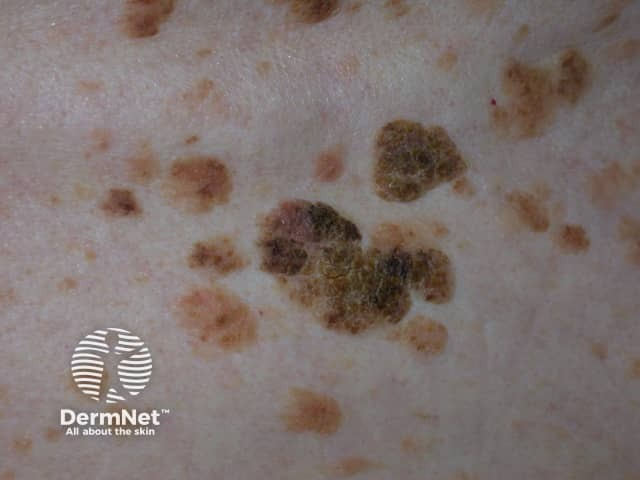
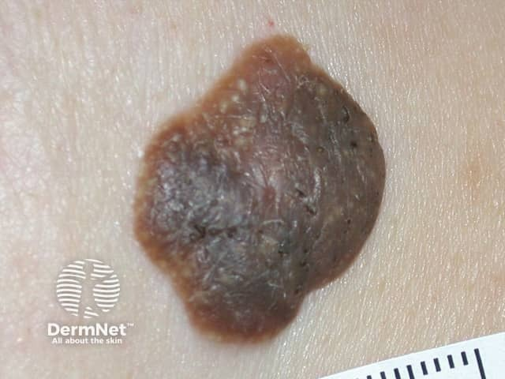

## 脂漏性角化症（俗稱老人斑） {#atlas-d52}

**多發、界線清楚、蠟樣厚片貼在皮膚上：seborrhoeic keratosis。** [@A:d52]

### 辨認特徵

- 界線清楚、像貼在皮膚表面的蠟樣或疣狀丘疹／斑塊（stuck-on）。 [@A:d52]
- 色澤可從淡黃、棕色至黑色，表面粗糙、有皺褶或腦迴樣紋理。 [@A:d52]
- 常多發於軀幹、臉或頸；皮膚鏡可見粟粒樣囊腫及粉刺樣開口，但並非每顆都有。 [@A:d52]

### 最容易混淆

- 與黑色素瘤／色素型 BCC：黑色或發炎 SK 可非常相似；不典型、明顯變化者要進一步評估。 [@A:d52]
- 與日光性黑子：後者通常是平坦色素斑，沒有明顯貼附、角化或疣狀表面。 [@A:d52]

### 驗證方法

多依臨床及皮膚鏡判讀；不能確定者切片。典型病灶不出現在掌蹠與黏膜。 [@A:d52]

### 判讀限制

**『老人斑』是俗稱，可能混指日光性黑子；SK 的圖像關鍵在表面質地與貼附感，不單是年紀或褐色。** [@A:d52]

### 圖像對照

<figure class="clinical-image" data-asset-id="asset-dermatology-f6bcb59cb086f5ea"><figcaption>臨床照片 多顆界線清楚的棕色斑塊散在分布，較厚病灶表面粗糙如貼附物。Image sourced from DermNet · © DermNet · 原圖／出處 · <a href="https://dermnetnz.org/imagedetail/8610-seborrhoeic-keratosis" target="_blank" rel="noopener">原圖來源</a> · <a href="https://creativecommons.org/licenses/by-nc-nd/4.0/" target="_blank" rel="noopener">CC BY-NC-ND 4.0</a> · 原圖未修改</figcaption></figure>
<figure class="clinical-image" data-asset-id="asset-dermatology-407c18fc52b8a235"><figcaption>臨床照片 深褐色隆起斑塊界線銳利，表面呈皺褶與疣狀角化紋理。Image sourced from DermNet · © DermNet · 原圖／出處 · <a href="https://dermnetnz.org/imagedetail/8567-pigmented-seborrhoeic-keratosis" target="_blank" rel="noopener">原圖來源</a> · <a href="https://creativecommons.org/licenses/by-nc-nd/4.0/" target="_blank" rel="noopener">CC BY-NC-ND 4.0</a> · 原圖未修改</figcaption></figure>

[@A:d52]

### 講義所列參考頁

查看外部參考連結

以下連結由講義提供，未將這些原文視為本次已完整閱讀的獨立來源。
<ul><li><a href="https://dermnetnz.org/topics/seborrhoeic-keratosis" target="_blank" rel="noopener">DermNet: Seborrhoeic keratosis</a></li><li><a href="https://www.aad.org/public/diseases/a-z/seborrheic-keratoses-symptoms" target="_blank" rel="noopener">AAD: Seborrheic keratoses signs and symptoms</a></li></ul>

## 延伸閱讀

- [黑色素瘤](melanoma.md#atlas-d39)
