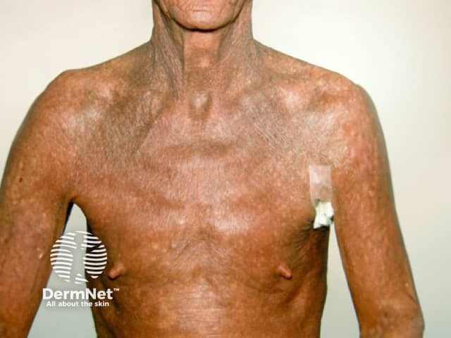
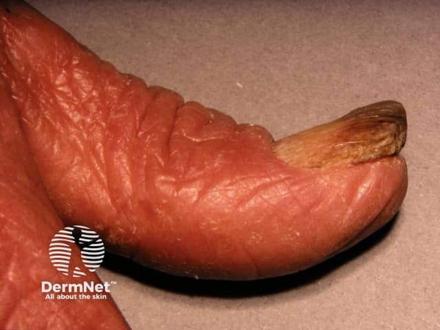
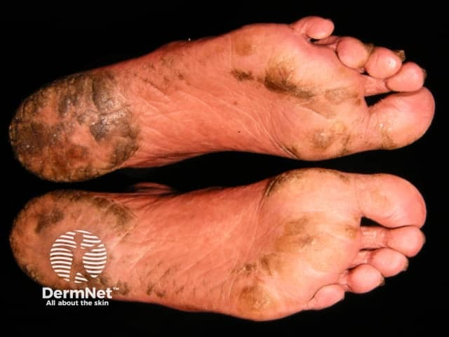

## Sézary 症候群（白血病型皮膚 T 細胞淋巴瘤） {#atlas-d57}

**紅皮症＋劇癢＋淋巴結腫大，再加上血中克隆性異常 T 細胞證據 → 考慮 Sézary syndrome。** [@B:d57]

### 辨認特徵

- 主要圖像是廣泛紅斑伴脫屑，可呈濕疹樣；在 MF／SS 分期中，T4 紅皮症採至少 80% 體表受累。 [@B:d57]
- 常伴明顯搔癢；可有掌蹠角化增厚、裂隙、落髮、指甲變形或眼瞼外翻。 [@B:d57]
- 題幹若補上廣泛淋巴結腫大與周邊血液腫瘤性 T 細胞，才使 Sézary 的辨識更具特異性。 [@B:d57]
- 照片中的紅皮與脫屑不能單獨區分 Sézary、紅皮型 MF 或其他紅皮症。 [@B:d57]

### 最容易混淆

- 紅皮型 MF：同樣可廣泛紅與脫屑；需既往病程、血液腫瘤負荷、TCR 克隆與皮膚病理整合判斷。 [@B:d57]
- 紅皮型乾癬、嚴重濕疹或藥物相關紅皮症：尋找原有皮疹、用藥時序與切片線索。 [@B:d57]
- 其他 T 細胞腫瘤亦可有皮膚和血液表現；必要時評估 HTLV-1 等以排除成人 T 細胞白血病／淋巴瘤。 [@B:d57]

### 驗證方法

合併皮膚切片、周邊血流式細胞分析及 TCR 克隆性。B2 高血液腫瘤負荷以異常 T 細胞絕對數 ≥1,000/μL 評估，並確認血液克隆與皮膚疾病相符；不能只憑 CD4/CD8 比值或 CD7／CD26 缺失百分比確診。 [@B:d57]

### 判讀限制

**Sézary 與 MF 在現行分類中是不同疾病實體；不是「MF 的必然末期」。腦回狀核或單一異常表面標記也不能獨立證明此診斷。** [@B:d57]

### 分類與分期的使用情境

**MF 與 Sézary 為不同疾病實體，不能寫成必然的先後階段。一般紅皮症描述約 90% 體表；MF／SS 的 TNMB 分期 T4 採 ≥80%，用途不同。** [@B:ctcl][@B:corrections]

### 圖像對照

<figure class="clinical-image" data-asset-id="asset-dermatology-6754ce4b351884f6"><figcaption>臨床照片 來源為 Sézary 病例：胸頸與上肢廣泛紅褐色改變並有細屑；本圖無法呈現血液診斷證據。Image sourced from DermNet · © DermNet · 原圖／出處 · <a href="https://dermnetnz.org/imagedetail/10487-sezary-syndrome" target="_blank" rel="noopener">原圖來源</a> · <a href="https://creativecommons.org/licenses/by-nc-nd/4.0/" target="_blank" rel="noopener">CC BY-NC-ND 4.0</a> · 原圖未修改</figcaption></figure>
<figure class="clinical-image" data-asset-id="asset-dermatology-2e05d7100faae11c"><figcaption>臨床照片 甲變化：手指皮膚紅、皮紋明顯，指甲呈黃褐色且變形；此徵象不具單病專一性。Image sourced from DermNet · © DermNet · 原圖／出處 · <a href="https://dermnetnz.org/imagedetail/10486-sezary-syndrome" target="_blank" rel="noopener">原圖來源</a> · <a href="https://creativecommons.org/licenses/by-nc-nd/4.0/" target="_blank" rel="noopener">CC BY-NC-ND 4.0</a> · 原圖未修改</figcaption></figure>
<figure class="clinical-image" data-asset-id="asset-dermatology-a1e43896b348ecd6"><figcaption>臨床照片 足底角化：足跟及前足可見增厚角質與深色表面變化；仍須與全身及血液資料合併判讀。Image sourced from DermNet · © DermNet · 原圖／出處 · <a href="https://dermnetnz.org/imagedetail/6191-plantar-keratoderma-in-sezary-syndrome" target="_blank" rel="noopener">原圖來源</a> · <a href="https://creativecommons.org/licenses/by-nc-nd/4.0/" target="_blank" rel="noopener">CC BY-NC-ND 4.0</a> · 原圖未修改</figcaption></figure>

[@B:d57]

### 講義所列參考頁

查看外部參考連結

以下連結由講義提供，未將這些原文視為本次已完整閱讀的獨立來源。
<ul><li><a href="https://dermnetnz.org/topics/sezary-syndrome" target="_blank" rel="noopener">DermNet - Sézary syndrome（臨床圖像）</a></li><li><a href="https://pmc.ncbi.nlm.nih.gov/articles/PMC9353153/" target="_blank" rel="noopener">ISCL/USCLC/EORTC staging update (Blood, 2022)</a></li><li><a href="https://www.cancer.gov/types/lymphoma/hp/mycosis-fungoides-treatment-pdq" target="_blank" rel="noopener">NCI PDQ - Diagnostic blood criteria</a></li><li><a href="https://seer.cancer.gov/seertools/hemelymph/51f6cf56e3e27c3994bd52e2/" target="_blank" rel="noopener">NCI SEER / WHO5 - Separate entity from MF</a></li></ul>

## 延伸閱讀

- [紅皮症](erythroderma.md#atlas-d14)
- [蕈狀肉芽腫（皮膚 T 細胞淋巴瘤）](mycosis-fungoides.md#atlas-d56)
