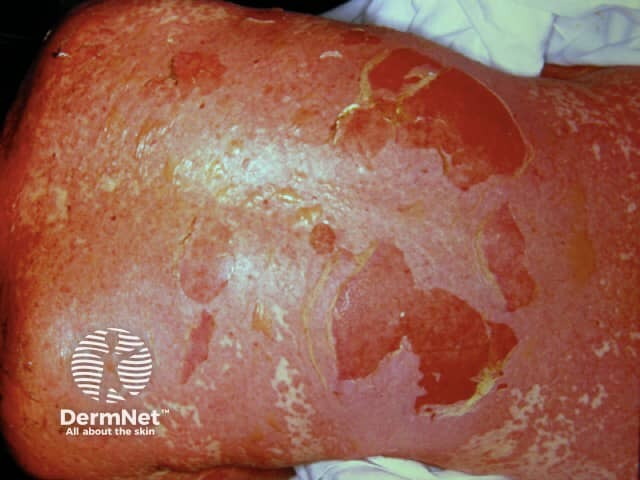
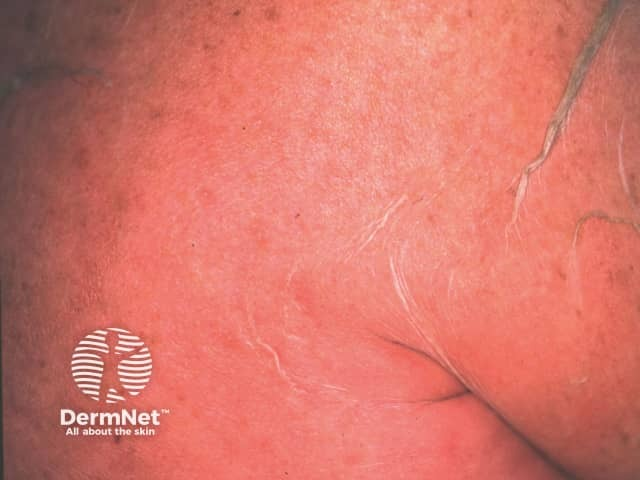
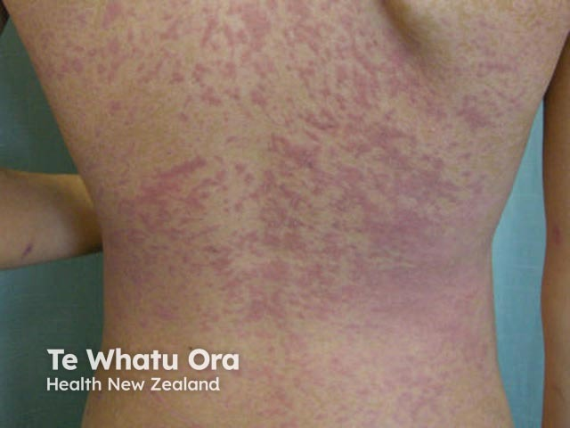
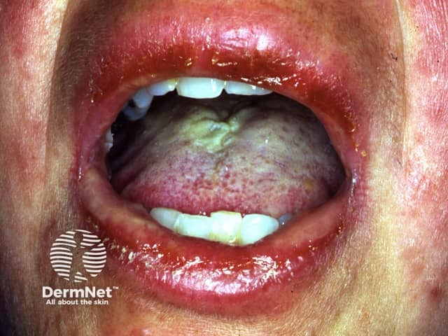
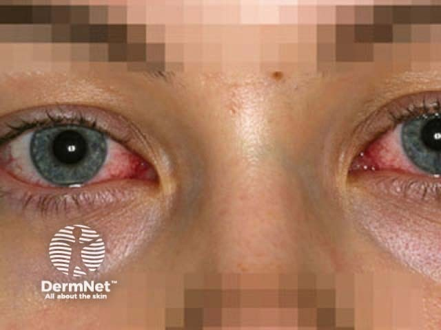

## 先建立核心概念

SJS 與 TEN 是伴隨表皮壞死、皮膚剝離及黏膜損傷的**嚴重黏膜皮膚反應**。發燒、全身倦怠、紅斑、糜爛及水疱可同時出現；眼部及呼吸道等併發症可能造成長期後遺症。[@H:1][@W:1]

> **閱讀重點**：辨認分型定義、追查可能致病藥物、評估皮膚以外器官，以及分清「指引建議」與「比較研究結果」。[@H:1-2][@W:3-11]

## 分型要先確認使用哪一套定義

| 分類系統 | SJS | SJS/TEN overlap | TEN |
| --- | --- | --- | --- |
| Heuer 採用的國際分型 | 剝離面積 <10% BSA | 10–30% BSA | >30% BSA |
| 日本 2025 診斷準則 | <10% BSA，並符合其他主準則 | 註記國際分型可將 10–30% 判為 overlap | 其主準則採 >10% BSA，並符合其他主準則 |

[@H:1][@W:9-10]

**定義差異尚未審閱。** 不能將兩套門檻混成同一個「全球通用診斷標準」；**面積也不能取代完整診斷與排除項目**。日本準則將輕壓可脫落的區域納入面積，且要求觀察完整病程。[@W:9-10]

## 流行病學與風險的尺度

Heuer 引述德國登錄的發生率為每百萬人每年 0.93 例（95% CI 0.86–1.00），此數字具有地域與來源限制。日本指引引述 2016–2018 全國調查的 315 例 SJS、174 例 TEN；CQ6 報告死亡率分別為 4.1% 與 29.9%。發生率、病例組成與死亡率是不同指標，不宜互換或直接套用其他地區。[@H:1][@W:2,4]

日本調查中常見的疑似藥物類別包括抗生素、解熱鎮痛消炎藥；亦討論抗癲癇藥與新型抗癌藥物。這是病例中的疑似藥物分布，**不等於每個藥物使用者發病的絕對風險**。[@W:2]

## 角質形成細胞為何死亡

指引描述：特定 HLA 背景下的藥物辨識與 T/NK 細胞活化，涉及 soluble Fas ligand、perforin/granzyme B、granulysin 以及 TNF-α。另一條路徑涉及單核球 annexin A1 與角質形成細胞 FPR1，參與 necroptosis；NETs 與 LL-37 亦與此機轉相關。這些是指引所整理的機轉，**不能直接當成個別病人的已驗證生物標記**。[@W:2]

## 臨床閱讀路徑

- **如何判斷與排除？** [診斷與評估](sjs-ten-diagnosis.md)：準則、病理、致病藥物與預後工具。
- **如何理解處置選項？** [處置與流程](sjs-ten-treatment.md)：支持照護與日本指引的分層流程。
- **皮膚以外要注意什麼？** [器官併發症](sjs-ten-organs.md)：眼部、肺、肝與腎。
- **兩種文獻為何說法不同？** [證據比較](../comparisons/sjs-ten-evidence.md)：比較對象、終點與不確定性。

## 尚未補齊的內容

完整舊版日本指引、Heuer 的線上補充表與個別原始研究未提供；支持照護的完整操作細節、完整藥物因果演算法及一般民眾衛教內容仍待後續資料。本站未自行補寫其細節。

<!-- ATLAS_INTEGRATION -->

## 毒性表皮壞死溶解症 {#atlas-d12}

**近期用藥＋皮膚疼痛＋黏膜糜爛＋表皮剝落，先辨識 SJS／TEN 譜系。** [@A:d12]

### 辨認特徵

- 廣泛觸痛的暗紅／紫紅斑、扁平非典型靶形斑，可迅速融合。 [@A:d12]
- 鬆弛水疱及大片表皮剝離，留下濕潤糜爛面；Nikolsky 徵可陽性。 [@A:d12]
- 口唇出血性結痂、口腔糜爛與眼／生殖器等黏膜病灶是重要線索。 [@A:d12]

### 最容易混淆

- SSSS：幼童較常見，剝離位置更淺，黏膜通常不受累。 [@A:d12]
- EM：典型為較隆起的三環靶、肢端對稱分布，並非 TEN 輕症。 [@A:d12]
- 廣泛水疱性 FDE：可有同處復發、清楚暗紅斑與正常皮膚間隔，仍須病史及切片判別。 [@A:d12]

### 驗證方法

採國際慣用分型，依已剝離／可剝離表皮 BSA：SJS <10%、重疊 10-30%、TEN >30%；病理支持全層表皮壞死。 [@A:d12]

### 判讀限制

**紅斑範圍不等於剝離面積；不能只看一張軀幹照片估全身 BSA，也不能用 Nikolsky 陽性直接判為 TEN。** [@A:d12]

### 圖像對照

<figure class="clinical-image" data-asset-id="asset-dermatology-ce5fa13acc3d2f99"><figcaption>臨床照片 軀幹可見大片表皮脫落，留下鮮紅糜爛面，邊緣殘留薄而捲起的表皮。Image sourced from DermNet · © DermNet · 原圖／出處 · <a href="https://dermnetnz.org/imagedetail/8151-toxic-epidermal-necrolysis" target="_blank" rel="noopener">原圖來源</a> · <a href="https://creativecommons.org/licenses/by-nc-nd/4.0/" target="_blank" rel="noopener">CC BY-NC-ND 4.0</a> · 原圖未修改</figcaption></figure>
<figure class="clinical-image" data-asset-id="asset-dermatology-4e76351e5bd86d47"><figcaption>臨床照片 大片紅色皮膚上可見鬆弛、皺縮的薄表皮與局部剝離邊緣。Image sourced from DermNet · © DermNet · 原圖／出處 · <a href="https://dermnetnz.org/imagedetail/8139-toxic-epidermal-necrolysis" target="_blank" rel="noopener">原圖來源</a> · <a href="https://creativecommons.org/licenses/by-nc-nd/4.0/" target="_blank" rel="noopener">CC BY-NC-ND 4.0</a> · 原圖未修改</figcaption></figure>

[@A:d12]

### 講義所列參考頁

查看外部參考連結

以下連結由講義提供，未將這些原文視為本次已完整閱讀的獨立來源。
<ul><li><a href="https://dermnetnz.org/topics/stevens-johnson-syndrome-toxic-epidermal-necrolysis" target="_blank" rel="noopener">DermNet - SJS/TEN</a></li><li><a href="https://dermnetnz.org/topics/staphylococcal-scalded-skin-syndrome" target="_blank" rel="noopener">DermNet - Staphylococcal scalded skin syndrome</a></li><li><a href="https://dermnetnz.org/topics/fixed-drug-eruption" target="_blank" rel="noopener">DermNet - Fixed drug eruption</a></li><li><a href="https://academic.oup.com/bjd/article/181/1/37/6747225" target="_blank" rel="noopener">British Association of Dermatologists - SJS/TEN guideline: detached and detachable epidermis</a></li><li><a href="https://onlinelibrary.wiley.com/doi/full/10.1111/ddg.15515" target="_blank" rel="noopener">S3 guideline (2024)</a></li></ul>

## 史蒂文生-強生症候群 {#atlas-d59}

**急性皮膚痛＋暗紅扁平靶形疹＋明顯黏膜糜爛 → 先考慮 SJS/TEN，再依全身表皮剝離範圍分型。** [@B:d59]

**左圖為 SJS/TEN 光譜皮疹；中、右圖來源標示 SJS。口眼照片本身不能區分 SJS 與 TEN。** [@B:d59]

### 辨認特徵

- 軀幹與臉部可見暗紅／紫紅色斑，或扁平、不完整的非典型靶形病灶；可融合並發展為鬆弛水疱及糜爛。 [@B:d59]
- 唇部出血性痂與疼痛口腔糜爛是常考照片；也可能合併結膜、眼表或生殖器黏膜病灶。 [@B:d59]
- 題幹常有急性發燒、明顯皮膚疼痛及近期用藥。病程中的表皮剝離範圍可能持續改變。 [@B:d59]
- SJS 與 TEN 屬表皮壞死溶解疾病光譜；SJS 的分類依據是已剝離／可剝離表皮面積小於全身 BSA 的 10%。 [@B:d59]

### 最容易混淆

- 多形性紅斑：典型為肢端對稱、可觸及的三區靶形疹，常與感染相關；EM 與 SJS/TEN 是不同疾病。 [@B:d59]
- SSSS：常見於幼兒、黏膜保留，切片分離在顆粒層；SJS/TEN 則以角質細胞壞死與較深分離為重點。 [@B:d59]
- 廣泛性大疱性固定型藥疹：尋找界線清楚的暗紅斑、斑間正常皮膚與同處復發史；嚴重病例仍需切片及臨床整合。 [@B:d59]

### 驗證方法

確認皮膚／黏膜病程與完整用藥時序；切片支持角質細胞壞死，成熟病灶可達全層表皮壞死。依全身已剝離／可剝離表皮 BSA 分型：SJS <10%、重疊型 10-30%、TEN >30%。 [@B:d59]

### 判讀限制

**不以全部紅斑面積計算分型，也不能從一張局部照片估算全身 BSA。SJS 剝離面積較小，仍可有嚴重黏膜與全身併發症；它不等於輕微藥疹。** [@B:d59]

### 圖像對照

<figure class="clinical-image" data-asset-id="asset-dermatology-cfd04fb0f8f7e7a2"><figcaption>臨床照片 SJS/TEN 光譜的皮疹示例：背部多發暗紅紫色斑融合。原圖未提供可據以分型的全身剝離面積。Image sourced from DermNet · © DermNet · 原圖／出處 · <a href="https://dermnetnz.org/imagedetail/15265-sjs-ten" target="_blank" rel="noopener">原圖來源</a> · <a href="https://creativecommons.org/licenses/by-nc-nd/4.0/" target="_blank" rel="noopener">CC BY-NC-ND 4.0</a> · 原圖未修改</figcaption></figure>
<figure class="clinical-image" data-asset-id="asset-dermatology-60699d694a6bdf4c"><figcaption>臨床照片 來源標示 SJS：嘴唇紅腫、表面糜爛與痂，口內亦見黏膜病灶。Image sourced from DermNet · © DermNet · 原圖／出處 · <a href="https://dermnetnz.org/imagedetail/8470-stevens-johnson-syndrome" target="_blank" rel="noopener">原圖來源</a> · <a href="https://creativecommons.org/licenses/by-nc-nd/4.0/" target="_blank" rel="noopener">CC BY-NC-ND 4.0</a> · 原圖未修改</figcaption></figure>
<figure class="clinical-image" data-asset-id="asset-dermatology-c1fd3c20e9a397c7"><figcaption>臨床照片 來源標示 SJS：雙側可見結膜充血；眼部嚴重程度須眼科檢查，無法僅由照片分級。Image sourced from DermNet · © DermNet · 原圖／出處 · <a href="https://dermnetnz.org/imagedetail/17815-stevens-johnson-syndrome" target="_blank" rel="noopener">原圖來源</a> · <a href="https://creativecommons.org/licenses/by-nc-nd/4.0/" target="_blank" rel="noopener">CC BY-NC-ND 4.0</a> · 原圖未修改</figcaption></figure>

[@B:d59]

### 講義所列參考頁

查看外部參考連結

以下連結由講義提供，未將這些原文視為本次已完整閱讀的獨立來源。
<ul><li><a href="https://onlinelibrary.wiley.com/doi/full/10.1111/ddg.15515" target="_blank" rel="noopener">S3 guideline: Diagnosis and treatment of epidermal necrolysis - Part 1 (2024)</a></li><li><a href="https://onlinelibrary.wiley.com/doi/full/10.1111/bjd.17841" target="_blank" rel="noopener">BAD guideline - SJS/TEN in children and young people (2018)</a></li><li><a href="https://dermnetnz.org/topics/stevens-johnson-syndrome-toxic-epidermal-necrolysis" target="_blank" rel="noopener">DermNet - SJS/TEN</a></li></ul>

## 延伸閱讀

- [多形性紅斑](erythema-multiforme.md#atlas-d06)
- [固定型藥物疹](fixed-drug-eruption.md#atlas-d08)
- [葡萄球菌燙傷樣皮膚症候群](staphylococcal-scalded-skin-syndrome.md#atlas-d58)
