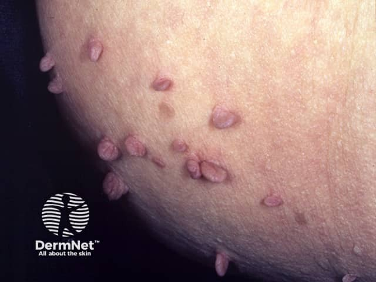
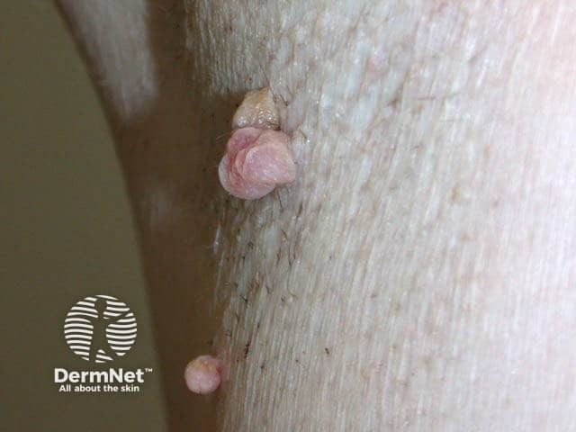

## 皮贅／軟纖維瘤 {#atlas-d53}

**皺摺處一小塊柔軟皮膚由細柄掛著：skin tag。** [@A:d53]

### 辨認特徵

- 柔軟、膚色或淡棕色的小突起，以細柄連接皮膚，呈下垂狀。 [@A:d53]
- 表面多平滑或輕微皺褶，比典型病毒疣柔軟，沒有厚實角化的粗糙外觀。 [@A:d53]
- 常見於頸、腋下、鼠蹊與眼皮等皺摺摩擦部位，可多顆並存。 [@A:d53]

### 最容易混淆

- 與絲狀病毒疣：疣較常粗糙、角化、呈指狀突起，且可擴散傳染。 [@A:d53]
- 與皮內痣／神經纖維瘤：也可膚色帶蒂；較大、異常或不典型病灶需觸診與必要的病理。 [@A:d53]

### 驗證方法

典型者臨床即可診斷；生殖器突起若表面乳突狀或成群，應與尖圭濕疣分辨。 [@A:d53]

### 判讀限制

**『皮膚贅疣』容易和 HPV 病毒疣混淆；皮贅通常是不具傳染性的良性增生。** [@A:d53]

### 圖像對照

<figure class="clinical-image" data-asset-id="asset-dermatology-56af0bb90acb8e9c"><figcaption>臨床照片 皮膚表面有多顆膚色至粉紅、以細柄連接的下垂小突起。Image sourced from DermNet · © DermNet · 原圖／出處 · <a href="https://dermnetnz.org/imagedetail/8877-skin-tags" target="_blank" rel="noopener">原圖來源</a> · <a href="https://creativecommons.org/licenses/by-nc-nd/4.0/" target="_blank" rel="noopener">CC BY-NC-ND 4.0</a> · 原圖未修改</figcaption></figure>
<figure class="clinical-image" data-asset-id="asset-dermatology-ef007dcce71d9734"><figcaption>臨床照片 皺摺旁可見帶蒂、外形圓潤的膚色至粉紅小腫塊。Image sourced from DermNet · © DermNet · 原圖／出處 · <a href="https://dermnetnz.org/imagedetail/14267-skin-tag" target="_blank" rel="noopener">原圖來源</a> · <a href="https://creativecommons.org/licenses/by-nc-nd/4.0/" target="_blank" rel="noopener">CC BY-NC-ND 4.0</a> · 原圖未修改</figcaption></figure>

[@A:d53]

### 講義所列參考頁

查看外部參考連結

以下連結由講義提供，未將這些原文視為本次已完整閱讀的獨立來源。
<ul><li><a href="https://dermnetnz.org/topics/skin-tag" target="_blank" rel="noopener">DermNet: Skin tag</a></li><li><a href="https://www.nidirect.gov.uk/conditions/skin-tags" target="_blank" rel="noopener">nidirect: Skin tags</a></li></ul>

## 延伸閱讀

- [尖圭濕疣／尖形濕疣](condyloma-acuminatum.md#atlas-d23)
