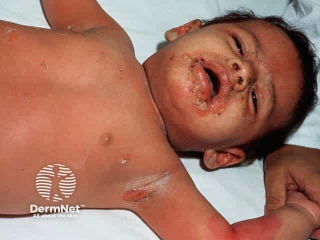
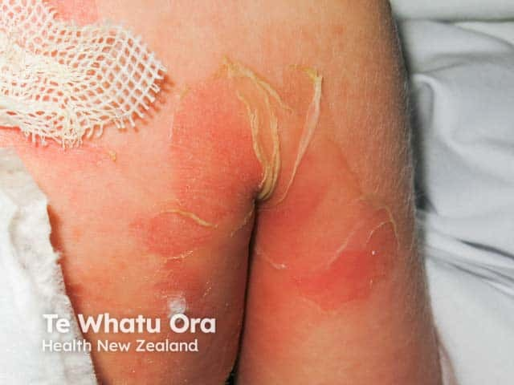
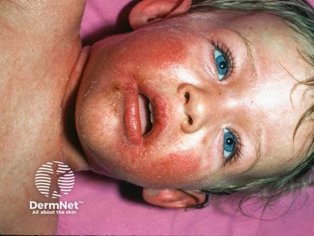

## 葡萄球菌燙傷樣皮膚症候群 {#atlas-d58}

**幼兒＋皺褶／口周開始的疼痛紅皮與表淺剝脫＋黏膜保留 → 想到 SSSS。** [@B:d58]

### 辨認特徵

- 瀰漫紅斑上出現極薄、鬆弛易破的水疱與大片表淺剝脫；殘留表皮可呈皺紙樣。 [@B:d58]
- 常從臉部及頸、腋、鼠蹊等皺褶區開始；口鼻周圍可有痂皮與放射狀裂隙。 [@B:d58]
- 口周皮膚病灶不等於口腔黏膜糜爛：真正的黏膜通常保留，是與 SJS/TEN 的重要區別。 [@B:d58]
- 題幹常是嬰幼兒急性發燒、煩躁、皮膚觸痛；成人可見於腎功能不全或免疫低下者。 [@B:d58]

### 最容易混淆

- SJS/TEN：黏膜糜爛通常突出，常有用藥時序；病理可見全層表皮壞死，不能只因 Nikolsky 陽性便區分。 [@B:d58]
- 大疱性膿痂疹：同與葡萄球菌剝脫毒素有關，但通常是較局限的水疱／痂皮，病灶中可檢出細菌。 [@B:d58]
- 遺傳性 EB：通常有自幼、反覆及摩擦相關起疱的病史；與 SSSS 的急性毒素性病程不同。 [@B:d58]

### 驗證方法

以病史與全身皮膚／黏膜檢查判斷，從可疑感染源採培養；完整疱液可為陰性，不能因此排除。必要時切片／冰凍切片確認顆粒層內的表淺裂隙；不呈 SJS/TEN 的全層表皮壞死。 [@B:d58]

### 判讀限制

**Nikolsky 陽性不專屬 SSSS；『像燙傷』描述外觀，並不是熱傷害。病理分離層次不能從普通照片直接看出。** [@B:d58]

### 圖像對照

<figure class="clinical-image" data-asset-id="asset-dermatology-dbaad579513017f7"><figcaption>臨床照片 幼童臉、口周與腋胸部可見紅斑、表淺剝落及痂皮；口周皮膚有痂不等於口腔黏膜糜爛。Image sourced from DermNet · © Dr Lawrence Meyerson · 原圖／出處 · <a href="https://dermnetnz.org/imagedetail/3257-staphylococcal-scalded-skin-syndrome" target="_blank" rel="noopener">原圖來源</a> · <a href="https://creativecommons.org/licenses/by-nc-nd/4.0/" target="_blank" rel="noopener">CC BY-NC-ND 4.0</a> · 原圖未修改</figcaption></figure>
<figure class="clinical-image" data-asset-id="asset-dermatology-833a06ff6cc56bf2"><figcaption>臨床照片 表淺剝脫近照：紅色皮膚上殘留薄而皺縮、捲起的表皮；照片無法直接判定組織分離層次。Image sourced from DermNet · © Te Whatu Ora · 原圖／出處 · <a href="https://dermnetnz.org/imagedetail/3258-staphylococcal-scalded-skin-syndrome" target="_blank" rel="noopener">原圖來源</a> · <a href="https://creativecommons.org/licenses/by-nc-nd/4.0/" target="_blank" rel="noopener">CC BY-NC-ND 4.0</a> · 原圖未修改</figcaption></figure>
<figure class="clinical-image" data-asset-id="asset-dermatology-d8c0d702e22af0ec"><figcaption>臨床照片 口鼻周圍的紅斑、痂與細裂隙是讀圖線索；真正口腔黏膜是否保留，仍須檢查。Image sourced from DermNet · © Dr Lawrence Meyerson · 原圖／出處 · <a href="https://dermnetnz.org/imagedetail/3251-staphylococcal-scalded-skin-syndrome" target="_blank" rel="noopener">原圖來源</a> · <a href="https://creativecommons.org/licenses/by-nc-nd/4.0/" target="_blank" rel="noopener">CC BY-NC-ND 4.0</a> · 原圖未修改</figcaption></figure>

[@B:d58]

### 講義所列參考頁

查看外部參考連結

以下連結由講義提供，未將這些原文視為本次已完整閱讀的獨立來源。
<ul><li><a href="https://dermnetnz.org/topics/staphylococcal-scalded-skin-syndrome" target="_blank" rel="noopener">DermNet - Staphylococcal scalded skin syndrome (updated 2025)</a></li><li><a href="https://onlinelibrary.wiley.com/doi/full/10.1111/bjd.17841" target="_blank" rel="noopener">BAD guideline - SJS/TEN in children and young people (2018)</a></li></ul>

## 延伸閱讀

- [毒性表皮壞死溶解症](sjs-ten.md#atlas-d12)
