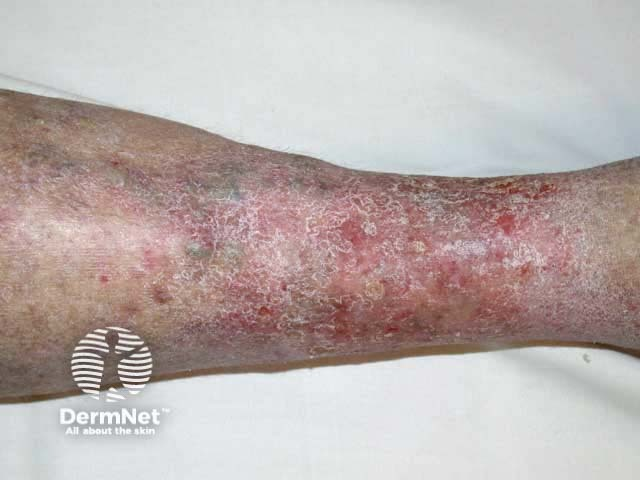
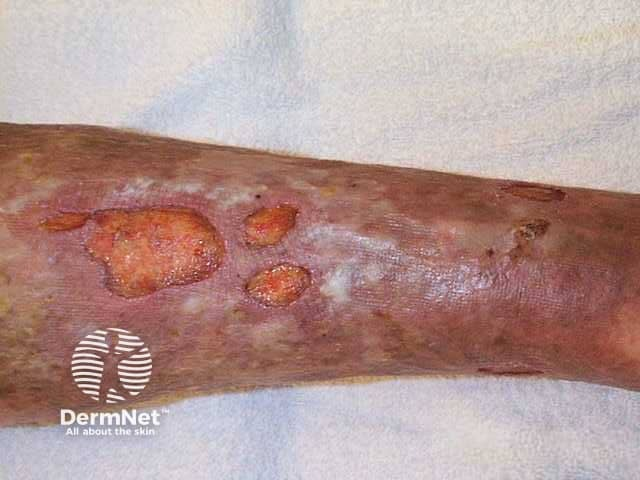

## 鬱滯性皮膚炎與靜脈性潰瘍 {#atlas-d20}

**內踝周圍濕疹＋慢性水腫＋褐色色素沉著，合併淺潰瘍 → 靜脈鬱滯。** [@A:d20]

### 辨認特徵

- 小腿下段、尤其內踝附近的紅斑、脫屑、滲液或結痂，常伴水腫。 [@A:d20]
- 慢性病灶呈橘褐／棕褐色含鐵血黃素沉著；可同時見靜脈曲張。 [@A:d20]
- 靜脈性潰瘍多位於踝上 gaiter area，常較淺、邊緣不規則且有滲液。 [@A:d20]

### 最容易混淆

- Lipodermatosclerosis：重點是皮下硬化、緊繃及倒香檳瓶形小腿；可與表面的濕疹並存。 [@A:d20]
- 蜂窩性組織炎：通常急性、單側、熱痛與擴散，慢性雙側脫屑較不支持。 [@A:d20]

### 驗證方法

看圖後仍須評估慢性靜脈病史、下肢脈搏與必要的血管檢查；潰瘍可有混合病因。 [@A:d20]

### 判讀限制

**不宜只背「腳跟紅」。典型位置是踝周與小腿下段；腳跟潰瘍還須想到壓力性損傷或動脈缺血。** [@A:d20]

### 圖像對照

<figure class="clinical-image" data-asset-id="asset-dermatology-82b5e3664aa3a2a4"><figcaption>臨床照片 小腿下段濕疹樣紅斑與廣泛細屑，伴棕褐色背景。Image sourced from DermNet · © DermNet · 原圖／出處 · <a href="https://dermnetnz.org/imagedetail/15193-venous-eczema" target="_blank" rel="noopener">原圖來源</a> · <a href="https://creativecommons.org/licenses/by-nc-nd/4.0/" target="_blank" rel="noopener">CC BY-NC-ND 4.0</a> · 原圖未修改</figcaption></figure>
<figure class="clinical-image" data-asset-id="asset-dermatology-a06c70ad383650f2"><figcaption>臨床照片 小腿下段數個不規則潰瘍，周圍皮膚色素沉著且發亮。Image sourced from DermNet · © DermNet · 原圖／出處 · <a href="https://dermnetnz.org/imagedetail/14012-venous-ulcer" target="_blank" rel="noopener">原圖來源</a> · <a href="https://creativecommons.org/licenses/by-nc-nd/4.0/" target="_blank" rel="noopener">CC BY-NC-ND 4.0</a> · 原圖未修改</figcaption></figure>

[@A:d20]

### 講義所列參考頁

查看外部參考連結

以下連結由講義提供，未將這些原文視為本次已完整閱讀的獨立來源。
<ul><li><a href="https://dermnetnz.org/topics/venous-eczema" target="_blank" rel="noopener">DermNet - Venous eczema</a></li><li><a href="https://www.aad.org/public/diseases/eczema/types/stasis-dermatitis/symptoms" target="_blank" rel="noopener">American Academy of Dermatology - Stasis dermatitis signs and symptoms</a></li><li><a href="https://dermnetnz.org/topics/cellulitis-mimics" target="_blank" rel="noopener">DermNet - Cellulitis mimics</a></li></ul>

## 延伸閱讀

- [脂性皮膚硬化症](lipodermatosclerosis.md#atlas-d17)
- [蜂窩性組織炎](cellulitis.md#atlas-d22)
- [壓力性損傷／壓瘡](pressure-injury.md#atlas-d42)
