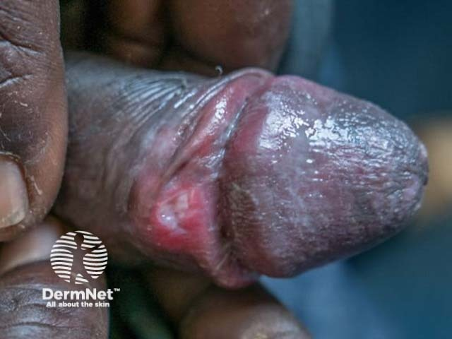
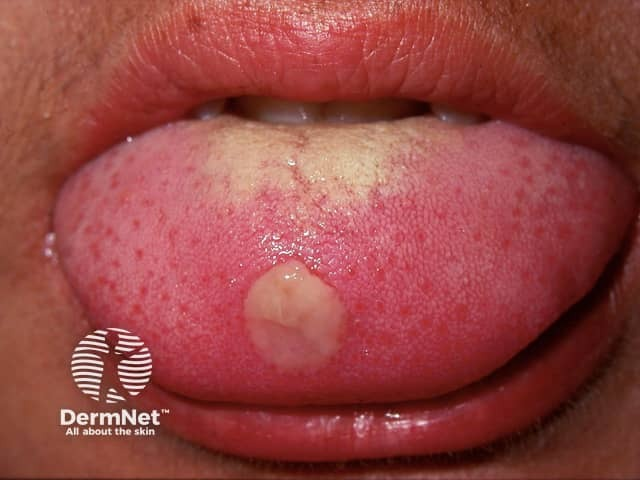
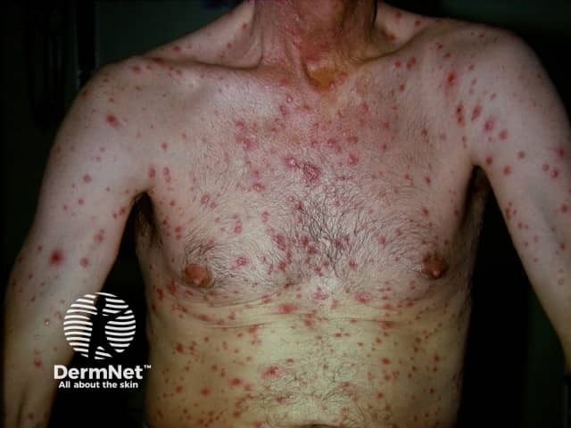
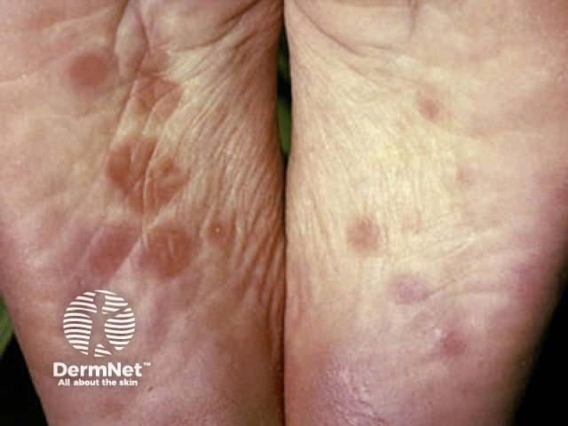

## 梅毒：一期硬性下疳 {#atlas-d29}

**接觸史＋無痛、硬底、界清潰瘍 → 一期梅毒硬性下疳。** [@A:d29]

### 辨認特徵

- 典型為生殖器、肛周或口腔接種處的單一潰瘍，邊界清楚。 [@A:d29]
- 潰瘍底較乾淨，周圍或基底呈硬結；硬度須靠觸診確認。 [@A:d29]
- 可伴區域淋巴結腫大；常被考題描述為無痛。 [@A:d29]

### 最容易混淆

- 生殖器疱疹：較常為痛的群聚水泡及多個淺糜爛；仍可能出現不典型外觀。 [@A:d29]
- 二期梅毒：以全身皮疹、掌蹠病灶、黏膜斑或扁平濕疣等表現為主。 [@A:d29]

### 驗證方法

以梅毒螺旋體與非螺旋體血清試驗配合判讀；可用病灶直接檢測，早期血清陰性仍須依情況追蹤。 [@A:d29]

### 判讀限制

**Syphilis 是疾病總稱，這頁特以一期皮疹作辨識。下疳可多發或疼痛，不能用「有痛」就排除梅毒。** [@A:d29]

### 圖像對照

<figure class="clinical-image" data-asset-id="asset-dermatology-c3fb2de0b474fd34"><figcaption>臨床照片 陰莖冠狀溝附近的單一潰瘍，示範生殖器一期梅毒病灶。Image sourced from DermNet · © DermNet · 原圖／出處 · <a href="https://dermnetnz.org/imagedetail/17034-syphilis" target="_blank" rel="noopener">原圖來源</a> · <a href="https://creativecommons.org/licenses/by-nc-nd/4.0/" target="_blank" rel="noopener">CC BY-NC-ND 4.0</a> · 原圖未修改</figcaption></figure>
<figure class="clinical-image" data-asset-id="asset-dermatology-a4428ad2d5421414"><figcaption>臨床照片 舌前部邊界較清楚的孤立潰瘍；硬度及疼痛不能由照片判斷。Image sourced from DermNet · © DermNet · 原圖／出處 · <a href="https://dermnetnz.org/imagedetail/7957-syphilis" target="_blank" rel="noopener">原圖來源</a> · <a href="https://creativecommons.org/licenses/by-nc-nd/4.0/" target="_blank" rel="noopener">CC BY-NC-ND 4.0</a> · 原圖未修改</figcaption></figure>

[@A:d29]

### 講義所列參考頁

查看外部參考連結

以下連結由講義提供，未將這些原文視為本次已完整閱讀的獨立來源。
<ul><li><a href="https://dermnetnz.org/topics/syphilis" target="_blank" rel="noopener">DermNet - Syphilis</a></li><li><a href="https://www.cdc.gov/std/treatment-guidelines/syphilis.htm" target="_blank" rel="noopener">CDC STI Treatment Guidelines - Syphilis</a></li></ul>

## 二期梅毒 {#atlas-d30}

**全身紅棕斑丘疹＋掌蹠疹，合併黏膜斑／扁平濕疣 → 二期梅毒。** [@A:d30]

### 辨認特徵

- 廣泛、常對稱的紅棕或銅紅色斑丘疹，可能帶少量鱗屑。 [@A:d30]
- 掌心與足底受累是重要考點；皮疹外觀可模仿多種疾病。 [@A:d30]
- 皺褶處可見潮濕、寬基底的扁平濕疣；另可能有黏膜斑與蟲蛀樣落髮。 [@A:d30]

### 最容易混淆

- 玫瑰糠疹或藥疹：可有軀幹疹，但需用掌蹠、黏膜、淋巴結與血清檢查區分。 [@A:d30]
- 尖形濕疣：較乳突／菜花狀；扁平濕疣較寬平且潮濕。 [@A:d30]

### 驗證方法

結合病史與兩類梅毒血清試驗；外觀不典型時可採切片與適當病原檢測。 [@A:d30]

### 判讀限制

**掌蹠紅疹不是梅毒專屬；二期梅毒通常不癢但並非絕對無癢，也不一定保留一期下疳。** [@A:d30]

### 圖像對照

<figure class="clinical-image" data-asset-id="asset-dermatology-3cf715a17cd225bc"><figcaption>臨床照片 軀幹與上肢廣泛紅棕色丘疹，部分帶細屑或結痂。Image sourced from DermNet · © DermNet · 原圖／出處 · <a href="https://dermnetnz.org/imagedetail/8004-syphilis" target="_blank" rel="noopener">原圖來源</a> · <a href="https://creativecommons.org/licenses/by-nc-nd/4.0/" target="_blank" rel="noopener">CC BY-NC-ND 4.0</a> · 原圖未修改</figcaption></figure>
<figure class="clinical-image" data-asset-id="asset-dermatology-fb0dde3144371416"><figcaption>臨床照片 雙側足底的紅棕色斑丘疹，部分帶環狀細屑；掌蹠受累可提示二期梅毒。Image sourced from DermNet · © DermNet · 原圖／出處 · <a href="https://dermnetnz.org/imagedetail/17788-syphilis" target="_blank" rel="noopener">原圖來源</a> · <a href="https://creativecommons.org/licenses/by-nc-nd/4.0/" target="_blank" rel="noopener">CC BY-NC-ND 4.0</a> · 原圖未修改</figcaption></figure>

[@A:d30]

### 講義所列參考頁

查看外部參考連結

以下連結由講義提供，未將這些原文視為本次已完整閱讀的獨立來源。
<ul><li><a href="https://dermnetnz.org/topics/syphilis" target="_blank" rel="noopener">DermNet - Syphilis</a></li><li><a href="https://www.cdc.gov/std/treatment-guidelines/syphilis.htm" target="_blank" rel="noopener">CDC STI Treatment Guidelines - Syphilis</a></li><li><a href="https://www.cdc.gov/std/treatment-guidelines/anogenital-warts.htm" target="_blank" rel="noopener">CDC STI Treatment Guidelines - Anogenital warts (condyloma lata differential)</a></li></ul>

