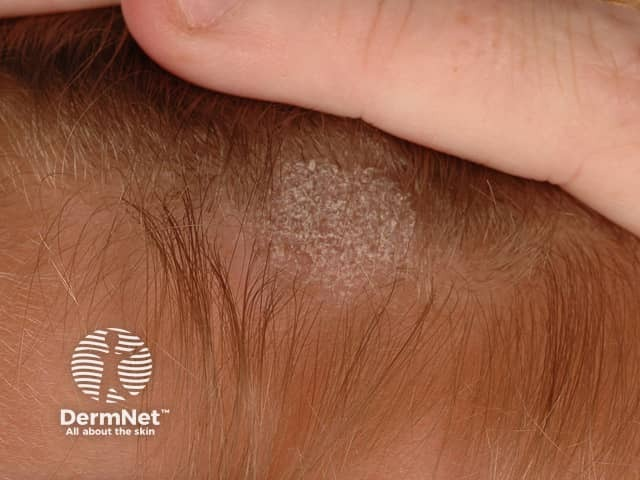
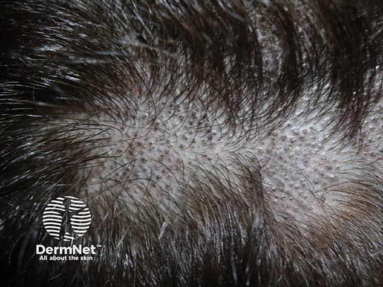
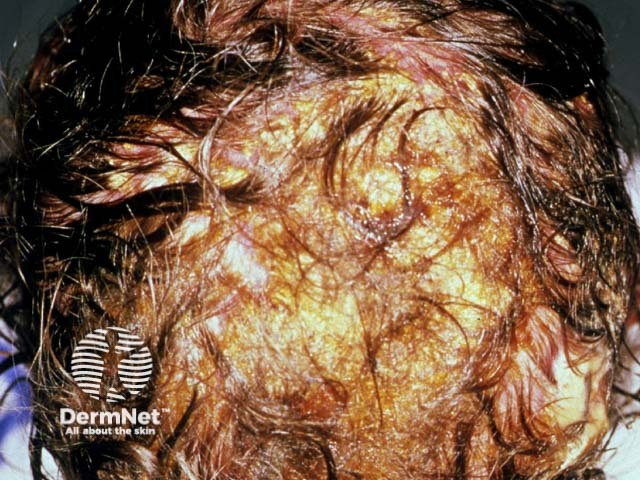

## 頭癬 {#atlas-d31}

**兒童局部落髮＋屑＋斷髮／黑點 → 頭癬。** [@A:d31]

### 辨認特徵

- 頭皮局部落髮合併鱗屑、紅斑及折斷毛髮，常見於兒童。 [@A:d31]
- 灰斑型可見灰白屑與短斷髮；黑點型為髮幹近頭皮折斷留下黑點。 [@A:d31]
- 發炎型 kerion 呈柔軟隆起、紅腫的斑塊，伴膿疱、滲液與落髮。 [@A:d31]

### 最容易混淆

- 圓禿：通常表面平滑、缺乏明顯鱗屑；黑點也可能出現，須合併其他特徵。 [@A:d31]
- 拔毛症：不規則範圍與不同長度斷髮；皮膚鏡與真菌檢查幫助區分。 [@A:d31]

### 驗證方法

取鱗屑及受影響毛髮作 KOH／培養；皮膚鏡可見 comma、corkscrew 或 Morse-code hairs。 [@A:d31]

### 判讀限制

**Wood lamp 陰性不能排除頭癬；只有部分菌種會螢光。Kerion 不應只因看起來像膿瘍就忽略真菌病因。** [@A:d31]

### 圖像對照

<figure class="clinical-image" data-asset-id="asset-dermatology-0f4a70d116b3aa74"><figcaption>臨床照片 頭皮局部落髮、灰白鱗屑與殘留短毛，示範灰斑型頭癬。Image sourced from DermNet · © DermNet · 原圖／出處 · <a href="https://dermnetnz.org/imagedetail/9955-tinea-capitis" target="_blank" rel="noopener">原圖來源</a> · <a href="https://creativecommons.org/licenses/by-nc-nd/4.0/" target="_blank" rel="noopener">CC BY-NC-ND 4.0</a> · 原圖未修改</figcaption></figure>
<figure class="clinical-image" data-asset-id="asset-dermatology-7c1416b61bc94425"><figcaption>臨床照片 落髮區仍有密集短斷髮與黑點，同時可見鱗屑。Image sourced from DermNet · © DermNet · 原圖／出處 · <a href="https://dermnetnz.org/imagedetail/9961-tinea-capitis" target="_blank" rel="noopener">原圖來源</a> · <a href="https://creativecommons.org/licenses/by-nc-nd/4.0/" target="_blank" rel="noopener">CC BY-NC-ND 4.0</a> · 原圖未修改</figcaption></figure>
<figure class="clinical-image" data-asset-id="asset-dermatology-cb999b3231939a33"><figcaption>臨床照片 明顯發炎型頭癬：厚痂、黏結的毛髮與落髮；腫塊波動感須觸診。Image sourced from DermNet · © DermNet · 原圖／出處 · <a href="https://dermnetnz.org/imagedetail/17316-tinea-capitis" target="_blank" rel="noopener">原圖來源</a> · <a href="https://creativecommons.org/licenses/by-nc-nd/4.0/" target="_blank" rel="noopener">CC BY-NC-ND 4.0</a> · 原圖未修改</figcaption></figure>

[@A:d31]

### 講義所列參考頁

查看外部參考連結

以下連結由講義提供，未將這些原文視為本次已完整閱讀的獨立來源。
<ul><li><a href="https://dermnetnz.org/topics/tinea-capitis" target="_blank" rel="noopener">DermNet - Tinea capitis</a></li></ul>

## 延伸閱讀

- [圓禿](alopecia-areata.md#atlas-d02)
