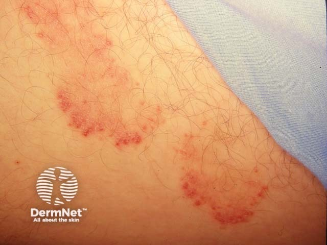
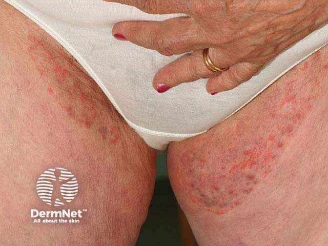

## 股癬 {#atlas-d32}

**鼠蹊不對稱環形斑＋隆起脫屑邊緣＋中央淡化 → 股癬。** [@A:d32]

### 辨認特徵

- 腹股溝向大腿內側延伸的弧形或環形紅褐斑塊，常不對稱。 [@A:d32]
- 外緣隆起、鱗屑較多，形成活動性邊緣；中央相對淡化。 [@A:d32]
- 典型較少侵犯陰囊與陰莖，但病變廣泛或受類固醇修飾時可不典型。 [@A:d32]

### 最容易混淆

- 念珠菌間擦疹：濕紅、糜爛且常有周邊衛星丘疹／膿疱，可累及陰囊。 [@A:d32]
- 紅癬：較均勻紅棕色薄斑，Wood lamp 可呈珊瑚紅螢光。 [@A:d32]

### 驗證方法

從活動性邊緣刮屑作 KOH，必要時培養；同時尋找足癬／甲癬的感染來源。 [@A:d32]

### 判讀限制

**不是所有鼠蹊癢都是股癬；擦類固醇後可變成 tinea incognito，典型環形邊緣不明顯。** [@A:d32]

### 增補校正

股癬的典型定位是鼠蹊與大腿內側，需觀察活動性鱗屑邊緣。 [@B:corrections]

### 圖像對照

<figure class="clinical-image" data-asset-id="asset-dermatology-991330eb41b9ad46"><figcaption>臨床照片 環形紅斑的外緣較紅且隆起，中央較淡，呈活動性邊界。Image sourced from DermNet · © DermNet · 原圖／出處 · <a href="https://dermnetnz.org/imagedetail/17323-tinea-cruris" target="_blank" rel="noopener">原圖來源</a> · <a href="https://creativecommons.org/licenses/by-nc-nd/4.0/" target="_blank" rel="noopener">CC BY-NC-ND 4.0</a> · 原圖未修改</figcaption></figure>
<figure class="clinical-image" data-asset-id="asset-dermatology-a696547d1f871162"><figcaption>臨床照片 兩側但不對稱的鼠蹊與大腿內側病灶，外圍鱗屑邊較清楚。Image sourced from DermNet · © Raimo Suhonen · 原圖／出處 · <a href="https://dermnetnz.org/imagedetail/19732-tineacrur2" target="_blank" rel="noopener">原圖來源</a> · <a href="https://creativecommons.org/licenses/by-nc-nd/4.0/" target="_blank" rel="noopener">CC BY-NC-ND 4.0</a> · 原圖未修改</figcaption></figure>

[@A:d32]

### 講義所列參考頁

查看外部參考連結

以下連結由講義提供，未將這些原文視為本次已完整閱讀的獨立來源。
<ul><li><a href="https://dermnetnz.org/topics/tinea-cruris" target="_blank" rel="noopener">DermNet - Tinea cruris</a></li><li><a href="https://dermnetnz.org/topics/candidiasis-of-skin-folds" target="_blank" rel="noopener">DermNet - Candidal intertrigo</a></li><li><a href="https://dermnetnz.org/topics/erythrasma" target="_blank" rel="noopener">DermNet - Erythrasma</a></li></ul>

## 延伸閱讀

- [足癬／香港腳](tinea-pedis.md#atlas-d33)
