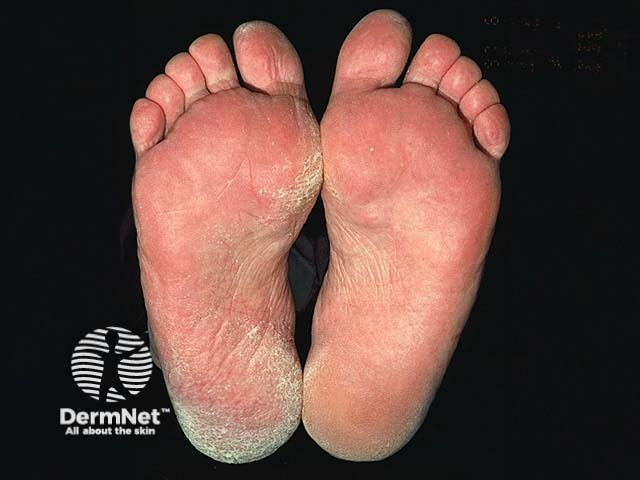
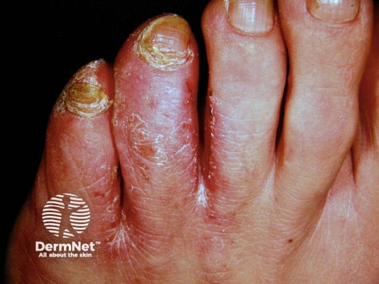
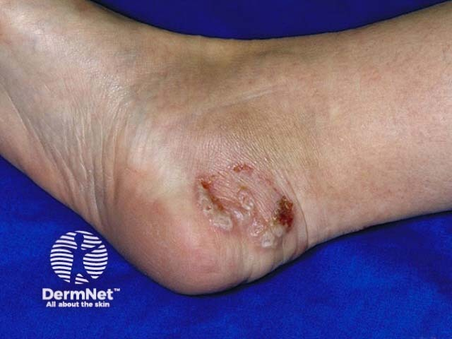

## 足癬／香港腳 {#atlas-d33}

**趾縫浸潤裂隙，或足底足側鞋套狀脫屑 → 足癬。** [@A:d33]

### 辨認特徵

- 趾間型：尤其第 4-5 趾縫的白色浸潤、脫屑、裂隙或糜爛。 [@A:d33]
- 鞋套型（moccasin）：足底及足側瀰漫乾燥、角化與細屑。 [@A:d33]
- 水泡型：足內側／足弓出現小至中型水泡，可和其他型態並存。 [@A:d33]

### 最容易混淆

- 汗皰疹：深在小水泡常對稱且很癢，真菌檢查陰性；兩者外觀可近似。 [@A:d33]
- 鞋材接觸性皮膚炎：分布符合接觸面，常雙側，需結合接觸史。 [@A:d33]

### 驗證方法

取活動性鱗屑或水泡頂作 KOH；檢視趾甲、手掌與鼠蹊是否有伴隨真菌感染。 [@A:d33]

### 判讀限制

**香港腳不是固定單一菌種；足癬也能起水泡，不能看到水泡就直接選汗皰疹。** [@A:d33]

### 圖像對照

<figure class="clinical-image" data-asset-id="asset-dermatology-c71ee16642583c67"><figcaption>臨床照片 足底與足緣大片細屑，呈鞋套型足癬分布。Image sourced from DermNet · © DermNet · 原圖／出處 · <a href="https://dermnetnz.org/imagedetail/19080-moccasin-tinea-pedis" target="_blank" rel="noopener">原圖來源</a> · <a href="https://creativecommons.org/licenses/by-nc-nd/4.0/" target="_blank" rel="noopener">CC BY-NC-ND 4.0</a> · 原圖未修改</figcaption></figure>
<figure class="clinical-image" data-asset-id="asset-dermatology-c0ba6c75af97a4f7"><figcaption>臨床照片 趾縫周圍脫屑、浸軟與裂隙，並可見趾甲增厚變色。Image sourced from DermNet · © DermNet · 原圖／出處 · <a href="https://dermnetnz.org/imagedetail/17329-tinea-pedis" target="_blank" rel="noopener">原圖來源</a> · <a href="https://creativecommons.org/licenses/by-nc-nd/4.0/" target="_blank" rel="noopener">CC BY-NC-ND 4.0</a> · 原圖未修改</figcaption></figure>
<figure class="clinical-image" data-asset-id="asset-dermatology-22694556d0a8a539"><figcaption>臨床照片 足部局部群聚水疱及破裂後的環狀脫屑，示範水疱型足癬。Image sourced from DermNet · © DermNet · 原圖／出處 · <a href="https://dermnetnz.org/imagedetail/19078-tinea-pedis" target="_blank" rel="noopener">原圖來源</a> · <a href="https://creativecommons.org/licenses/by-nc-nd/4.0/" target="_blank" rel="noopener">CC BY-NC-ND 4.0</a> · 原圖未修改</figcaption></figure>

[@A:d33]

### 講義所列參考頁

查看外部參考連結

以下連結由講義提供，未將這些原文視為本次已完整閱讀的獨立來源。
<ul><li><a href="https://dermnetnz.org/topics/tinea-pedis" target="_blank" rel="noopener">DermNet - Tinea pedis</a></li><li><a href="https://dermnetnz.org/topics/tinea-cruris" target="_blank" rel="noopener">DermNet - Tinea cruris</a></li></ul>

## 延伸閱讀

- [股癬](tinea-cruris.md#atlas-d32)
- [汗皰疹](pompholyx.md#atlas-d50)
