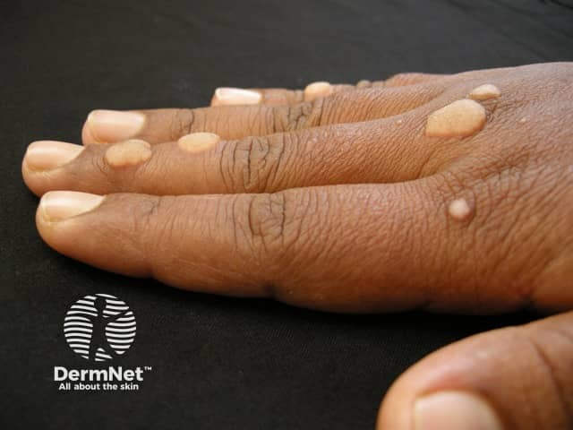
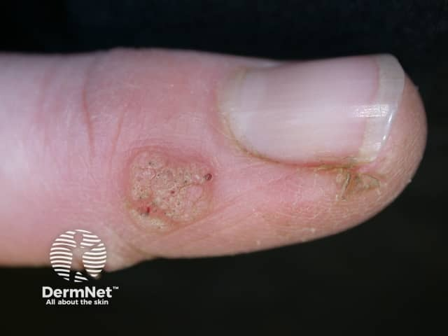
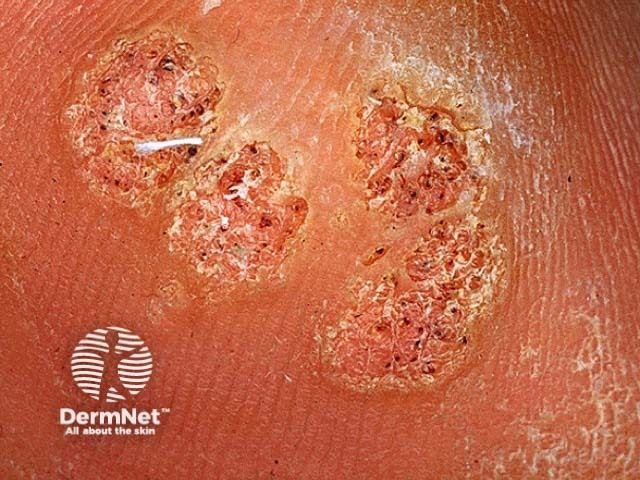

## 尋常疣 {#atlas-d36}

**手指粗糙角化丘疹＋黑紅小點＋皮紋中斷 → 尋常疣。** [@A:d36]

### 辨認特徵

- 膚色至灰褐色、堅實隆起的丘疹，表面粗糙、乳突狀且角化。 [@A:d36]
- 可見小黑點或紅點，代表表淺微血管／血栓化血管，削薄後較清楚。 [@A:d36]
- 常出現在手指、手背與甲周；病灶處皮紋可被打斷。 [@A:d36]

### 最容易混淆

- 雞眼／胼胝：常保留皮紋，雞眼可有中央角質栓，通常缺乏典型血管點。 [@A:d36]
- 傳染性軟疣：較光滑、發亮、中央臍凹；skin tag 則較柔軟有蒂。 [@A:d36]

### 驗證方法

典型病例可臨床與皮膚鏡判斷；持續生長、潰瘍或形態不典型時考慮切片排除腫瘤。 [@A:d36]

### 判讀限制

**黑點不是「病毒根」。尋常疣由皮膚型 HPV 引起，不等同生殖器疣或必然與性接觸相關。** [@A:d36]

### 圖像對照

<figure class="clinical-image" data-asset-id="asset-dermatology-f9f723fadf265f46"><figcaption>臨床照片 手背與指部多顆膚色角化丘疹，表面較粗糙。Image sourced from DermNet · © DermNet · 原圖／出處 · <a href="https://dermnetnz.org/imagedetail/10092-viral-warts" target="_blank" rel="noopener">原圖來源</a> · <a href="https://creativecommons.org/licenses/by-nc-nd/4.0/" target="_blank" rel="noopener">CC BY-NC-ND 4.0</a> · 原圖未修改</figcaption></figure>
<figure class="clinical-image" data-asset-id="asset-dermatology-fe483c6616f0035b"><figcaption>臨床照片 拇指甲旁界清的角化丘疹，可見點狀血管與不規則表面。Image sourced from DermNet · © DermNet · 原圖／出處 · <a href="https://dermnetnz.org/imagedetail/10137-viral-warts" target="_blank" rel="noopener">原圖來源</a> · <a href="https://creativecommons.org/licenses/by-nc-nd/4.0/" target="_blank" rel="noopener">CC BY-NC-ND 4.0</a> · 原圖未修改</figcaption></figure>
<figure class="clinical-image" data-asset-id="asset-dermatology-e8623a5ba31619f7"><figcaption>近距離照片 近照見紅黑色血管小點及中斷的皮紋；黑點並不是病毒的根。Image sourced from DermNet · © DermNet · 原圖／出處 · <a href="https://dermnetnz.org/imagedetail/19136-viral-warts" target="_blank" rel="noopener">原圖來源</a> · <a href="https://creativecommons.org/licenses/by-nc-nd/4.0/" target="_blank" rel="noopener">CC BY-NC-ND 4.0</a> · 原圖未修改</figcaption></figure>

[@A:d36]

### 講義所列參考頁

查看外部參考連結

以下連結由講義提供，未將這些原文視為本次已完整閱讀的獨立來源。
<ul><li><a href="https://dermnetnz.org/topics/viral-wart" target="_blank" rel="noopener">DermNet - Viral wart</a></li><li><a href="https://dermnetnz.org/topics/molluscum-contagiosum" target="_blank" rel="noopener">DermNet - Molluscum contagiosum</a></li></ul>

## 延伸閱讀

- [傳染性軟疣](molluscum-contagiosum.md#atlas-d35)
- [皮贅／軟纖維瘤](skin-tag.md#atlas-d53)
