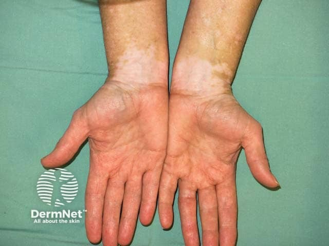
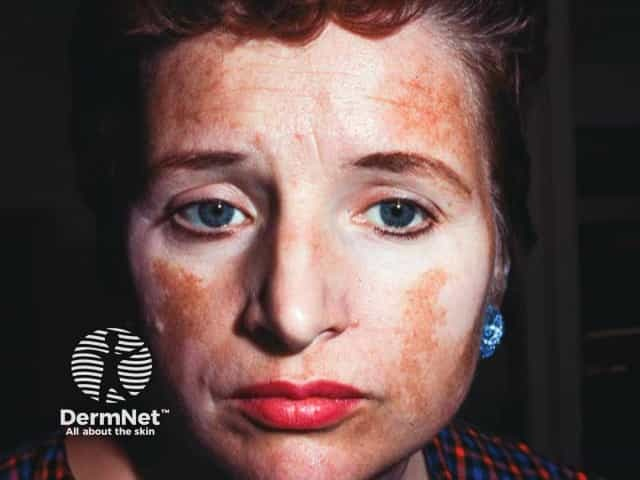

## 白斑症 {#atlas-d54}

**完全失色、邊界清楚、無鱗屑的白斑：想 vitiligo。** [@A:d54]

### 辨認特徵

- 乳白／粉筆白的脫色斑，邊界通常清楚，表面光滑、沒有細屑。 [@A:d54]
- 常見手指、關節、口眼周與其他體表開口；非節段型可左右對稱，斑塊可融合成不規則形。 [@A:d54]
- 病灶內毛髮可能變白；Wood lamp 下白色與邊界更明顯，有助辨認不顯眼病灶。 [@A:d54]

### 最容易混淆

- 與白色糠疹：後者只是色素變淡，邊緣較模糊，可有細屑，常見兒童臉頰。 [@A:d54]
- 與汗斑／發炎後色素減退：汗斑好發軀幹且有細屑；發炎後色素減退需找先前皮疹分布及病史。 [@A:d54]

### 驗證方法

依臨床分布及 Wood lamp 判讀；必要時排除真菌等其他白斑原因，並依情況評估相關自體免疫病。 [@A:d54]

### 判讀限制

**應寫『白斑』；不規則輪廓不如『脫色程度、無屑、清楚邊界』有用，也不是所有淺色斑都屬白斑症。** [@A:d54]

### 圖像對照

<figure class="clinical-image" data-asset-id="asset-dermatology-c1a0b4cb5bfef2de"><figcaption>臨床照片 雙側手腕呈大致對稱的白色斑塊，與正常膚色形成清楚界線。Image sourced from DermNet · © DermNet · 原圖／出處 · <a href="https://dermnetnz.org/imagedetail/2846-vitiligo" target="_blank" rel="noopener">原圖來源</a> · <a href="https://creativecommons.org/licenses/by-nc-nd/4.0/" target="_blank" rel="noopener">CC BY-NC-ND 4.0</a> · 原圖未修改</figcaption></figure>
<figure class="clinical-image" data-asset-id="asset-dermatology-0ffd1c73b2bd38f4"><figcaption>臨床照片 臉部中央與雙眼周有大片白色脫色區，外側仍保留棕色皮膚。Image sourced from DermNet · © Dr Lawrence Meyerson · 原圖／出處 · <a href="https://dermnetnz.org/imagedetail/2826-vitiligo" target="_blank" rel="noopener">原圖來源</a> · <a href="https://creativecommons.org/licenses/by-nc-nd/4.0/" target="_blank" rel="noopener">CC BY-NC-ND 4.0</a> · 原圖未修改</figcaption></figure>

[@A:d54]

### 講義所列參考頁

查看外部參考連結

以下連結由講義提供，未將這些原文視為本次已完整閱讀的獨立來源。
<ul><li><a href="https://dermnetnz.org/topics/vitiligo" target="_blank" rel="noopener">DermNet: Vitiligo</a></li><li><a href="https://www.aad.org/public/diseases/a-z/vitiligo-symptoms" target="_blank" rel="noopener">AAD: Vitiligo signs and symptoms</a></li></ul>

## 延伸閱讀

- [白色糠疹](pityriasis-alba.md#atlas-d27)
