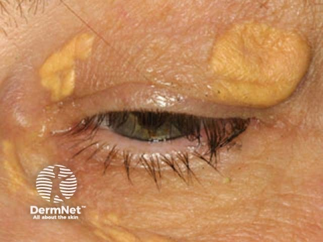
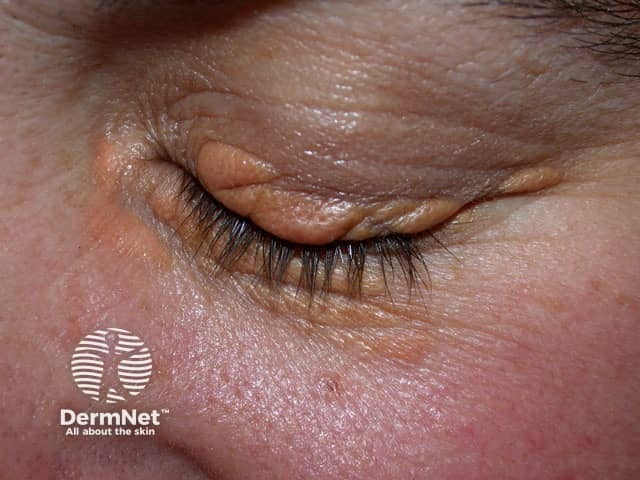

## 眼瞼黃斑瘤／眼瞼黃色瘤 {#atlas-d55}

**雙側內眼角的黃色平滑斑塊：xanthelasma。** [@A:d55]

### 辨認特徵

- 眼皮內側、靠近內眼角的黃色至黃橘色斑塊，常兩側相似。 [@A:d55]
- 表面平滑，可平坦或稍隆起，質地偏軟；上眼瞼常見，下眼瞼亦可有。 [@A:d55]
- 通常緩慢擴大，沒有疣狀角化、膿疱或明顯發炎紅底。 [@A:d55]

### 最容易混淆

- 與粟粒腫：milia 為一粒粒白色、堅實小丘疹，不是大片黃色扁平斑塊。 [@A:d55]
- 與汗管瘤：syringoma 常是多發細小膚色丘疹，偏下眼皮，沒有典型片狀黃色外觀。 [@A:d55]

### 驗證方法

典型外觀可臨床診斷；檢查血脂及相關代謝風險，因外觀不能推定血中膽固醇濃度。 [@A:d55]

### 判讀限制

**眼瞼黃斑瘤可出現在血脂正常者；『看到黃色瘤就一定高血脂』不正確。** [@A:d55]

### 圖像對照

<figure class="clinical-image" data-asset-id="asset-dermatology-8ca19af2e2a4b56c"><figcaption>臨床照片 上眼瞼可見數塊鮮黃色、平滑而微隆起的斑塊。Image sourced from DermNet · © DermNet · 原圖／出處 · <a href="https://dermnetnz.org/imagedetail/17699-xanthelasma" target="_blank" rel="noopener">原圖來源</a> · <a href="https://creativecommons.org/licenses/by-nc-nd/4.0/" target="_blank" rel="noopener">CC BY-NC-ND 4.0</a> · 原圖未修改</figcaption></figure>
<figure class="clinical-image" data-asset-id="asset-dermatology-1b614b20a6cfb2ee"><figcaption>臨床照片 眼瞼表面可見較淡的黃褐色、平滑微隆起斑塊。Image sourced from DermNet · © DermNet · 原圖／出處 · <a href="https://dermnetnz.org/imagedetail/7773-xanthelasma" target="_blank" rel="noopener">原圖來源</a> · <a href="https://creativecommons.org/licenses/by-nc-nd/4.0/" target="_blank" rel="noopener">CC BY-NC-ND 4.0</a> · 原圖未修改</figcaption></figure>

[@A:d55]

### 講義所列參考頁

查看外部參考連結

以下連結由講義提供，未將這些原文視為本次已完整閱讀的獨立來源。
<ul><li><a href="https://dermnetnz.org/topics/xanthoma" target="_blank" rel="noopener">DermNet: Xanthoma, xanthelasma section</a></li><li><a href="https://my.clevelandclinic.org/health/diseases/23385-xanthelasma" target="_blank" rel="noopener">Cleveland Clinic: Xanthelasma</a></li></ul>

